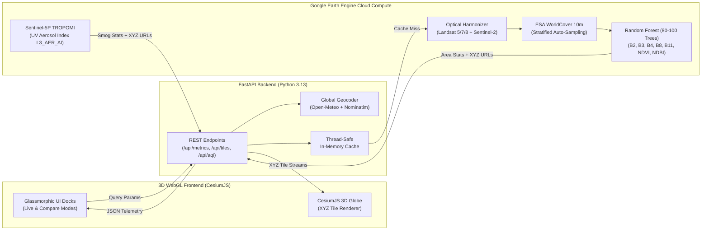

# 🌍 GeoGuardian 3D
### Global Urban Expansion & Atmospheric Smog Intelligence Platform

**An autonomous, full-stack GeoAI platform that combines multi-decadal satellite harmonization (1984–2026), on-the-fly Random Forest land-cover classification, and daily atmospheric aerosol tracking inside an interactive 3D WebGL Earth globe.**

[Features](#-key-features) • [System Architecture](#-system-architecture) • [Satellite Pipeline](#-multi-sensor-harmonization--ml-pipeline) • [Quick Start](#-quick-start--installation) • [API Reference](#-api-reference) • [Evaluation & Validation](#-evaluation--validation)

---

## 📖 Overview

Rapid, unregulated urban sprawl and seasonal atmospheric smog present critical environmental challenges across developing metropolitan regions worldwide. **GeoGuardian 3D** eliminates static, notebook-bound GIS workflows by connecting a live **FastAPI + Google Earth Engine (GEE)** compute engine directly to a glassmorphic **CesiumJS 3D Globe**.

Users can query **any city, district, or province worldwide**, dynamically train a localized machine learning classifier adapted to that region's terrain, quantify agricultural-to-urban land conversion in square kilometers, and inspect daily UV Aerosol Index smog plumes and surface air quality in real time.

  

---

## ✨ Key Features

- **🌐 Global On-Demand Geocoding & AOI Extraction:** Search any city or region worldwide via integrated Open-Meteo and Nominatim geocoding, automatically generating an optimized bounding box and flying the 3D camera directly to the target coordinates.
- **🛰️ 40+ Year Multi-Satellite Harmonization (1984–2026):** Seamlessly bridges historical **Landsat 5, 7, and 8** (30m) archives with modern **Sentinel-2** (10m) optical composites by normalizing surface reflectance scales and spectral indices (`NDVI`, `NDBI`).
- **🧠 Self-Adapting Local Random Forest Classifier:** Dynamically samples stratified ground-truth training pixels from **ESA WorldCover 10m** (`ESA/WorldCover/v200`) inside the active region and trains an 80–100 tree `smileRandomForest` classifier on the fly.
- **⚡ Dual Operational Modes:**
  * **Live Monitor Mode:** Tracks the latest cloud-free optical land cover alongside live **Sentinel-5P TROPOMI** UV Aerosol Index smog plumes (including single-date historical smog lookup) and lazy-loaded ground-level **US AQI / PM2.5 / PM10** telemetry.
  * **Historical Comparison Mode:** Compares any two arbitrary years between `1984` and `2026`, generating a binary red change-detection mask highlighting vegetation converted into built-up urban infrastructure.
- **💎 Modern 3D Glassmorphic UI:** Built on **CesiumJS** with frosted-glass docks (`backdrop-filter: blur(24px)`), spring-animated tab switchers, collapsible cinema-mode floating action buttons (FABs), 3D horizon tilt (`-42°` pitch), and real-time layer opacity sliders.
- **🚀 Thread-Safe Caching & Single-Pass Reduction:** Combines all 6 area masks into a single multi-band `ee.Image.cat()` reduction call, reducing GEE latency by 3x and serving repeat queries in `<10ms` from an in-memory cache.

---

## 🏗️ System Architecture

🔬 Multi-Sensor Harmonization & ML Pipeline1. Spectral Feature EngineeringTo classify land cover consistently across four decades of satellite sensors, all optical collections are scaled and mapped to a unified 7-band feature space:Optical Bands: Blue (B2), Green (B3), Red (B4), Near-Infrared (B8), Short-Wave Infrared 1 (B11).Normalized Difference Vegetation Index (NDVI):$$\text{NDVI} = \frac{\text{NIR} - \text{Red}}{\text{NIR} + \text{Red}} = \frac{B8 - B4}{B8 + B4}$$Normalized Difference Built-Up Index (NDBI):$$\text{NDBI} = \frac{\text{SWIR}_1 - \text{NIR}}{\text{SWIR}_1 + \text{NIR}} = \frac{B11 - B8}{B11 + B8}$$2. Satellite Sensor Routing TableEpochMission / SensorGEE Collection IDSpatial ResolutionRole1984 – 1998Landsat 5 TMLANDSAT/LT05/C02/T1_L230mHistorical Land Cover & Sprawl1999 – 2012Landsat 7 ETM+LANDSAT/LE07/C02/T1_L230mDecadal Urban Transition2013 – 2015Landsat 8 OLILANDSAT/LC08/C02/T1_L230mPre-Sentinel Baseline2016 – PresentSentinel-2 MSICOPERNICUS/S2_SR_HARMONIZED10mHigh-Res Optical & Live Land Cover2018 – PresentSentinel-5P TROPOMICOPERNICUS/S5P/OFFL/L3_AER_AI~1kmDaily Atmospheric Smog / UV AerosolReferenceESA WorldCover v200ESA/WorldCover/v20010mAutomated Ground-Truth Label Sampling3. Target Land-Cover Classes & Change LogicClass 0 (Vegetation / Farmland): Cropland, trees, shrubland, and grassy floodplains (#228B22).Class 1 (Built-Up / Urban): Concrete, residential developments, industrial zones, and road networks (#808080).Class 2 (Other / Barren / Water): Riverbeds, bare soil, and open water bodies (#EEDC82).Conversion Mask (Red): Computed pixel-wise via boolean intersection:$$\text{Converted} = (\text{Class}_{\text{Baseline}} == 0) \land (\text{Class}_{\text{Target}} == 1)$$🚀 Quick Start & InstallationPrerequisitesPython 3.10+ (tested on Python 3.13)A Google Cloud Project registered with Google Earth Engine1. Clone the Repository & Create Virtual EnvironmentPowerShellgit clone https://github.com/your-username/GeoGuardian3D.git
cd GeoGuardian3D

# Windows PowerShell
python -m venv venv
.\venv\Scripts\Activate.ps1
2. Install DependenciesPowerShellpip install --no-cache-dir -r requirements.txt
3. Authenticate Google Earth Engine (One-Time Setup)PowerShellearthengine authenticate
earthengine set_project YOUR_GCP_PROJECT_ID
(Update GCP_PROJECT_ID in your backend settings with your registered Google Cloud Project ID).4. Launch the FastAPI Backend (Terminal 1)PowerShelluvicorn backend.main:app --reload --port 8000
Swagger API Docs: [http://127.0.0.1:8000/docs](http://127.0.0.1:8000/docs)Health Check: [http://127.0.0.1:8000/health](http://127.0.0.1:8000/health)5. Launch the 3D Frontend Dashboard (Terminal 2)PowerShellpython -m http.server 5500 --directory frontend
Open [http://127.0.0.1:5500](http://127.0.0.1:5500) in Chrome, Edge, or Brave (ensure browser Hardware Acceleration is enabled for WebGL).🔌 API ReferenceGET /api/metricsComputes area telemetry (in $\text{km}^2$) and atmospheric aerosol statistics for any global location.Query Parameters:ParameterTypeDefaultDescriptionlocationstringDefault AOIAny city, district, or province worldwidemodestring"live""live" (baseline vs latest pass) or "compare" (year_a vs year_b)year_aint2019Baseline year (1984 – 2026)year_bint2025Target comparison year (1984 – 2026)smog_datestringnullOptional YYYY-MM-DD for date-specific Sentinel-5P smog inspectionrefreshboolfalseForces a fresh Earth Engine compute, bypassing cacheSample JSON Response:JSON{
  "mode": "live",
  "aoi": "Sample Metropolitan Region",
  "center": [0.0, 0.0],
  "bbox": [-0.22, -0.18, 0.22, 0.18],
  "total_area_sqkm": 1802.93,
  "year_a_label": "2015 (Landsat-8 30m)",
  "year_b_label": "2025 (Sentinel-2 10m)",
  "veg_a_sqkm": 1262.96,
  "veg_b_sqkm": 1045.91,
  "built_a_sqkm": 427.36,
  "built_b_sqkm": 565.97,
  "converted_sqkm": 215.85,
  "loss_pct": 11.97,
  "smog_a_index": 0.45,
  "smog_b_index": 0.12,
  "smog_status": "Low / Clear",
  "smog_date_window": "Live (14-day window)"
}
GET /api/aqiAsynchronously retrieves real-time surface air quality telemetry (US AQI, $\text{PM}_{2.5}$, and $\text{PM}_{10}$) for the active region without blocking 3D globe rendering.GET /api/tilesReturns Google Earth Engine XYZ web tile template URLs ([https://earthengine.googleapis.com/v1/.../tiles/](https://earthengine.googleapis.com/v1/.../tiles/){z}/{x}/{y}) for rgb_a, rgb_b, class_a, class_b, change, smog_a, and smog_b.📊 Evaluation & ValidationQuantitative Change Detection: Across a 1,802.93 km² test AOI over a 10-year window (2015–2025), multi-sensor change detection identified 215.85 km² (11.97%) of agricultural vegetation converted into built-up urban infrastructure (427.36 km² $\rightarrow$ 565.97 km²).Validation Methodology:Stratified Ground-Truth Audit: 50 stratified validation points comparing predicted Random Forest labels against high-resolution reference imagery.Spectral Error Analysis: 15-case audit examining boundary mixed-pixels (mixels), seasonal fallow cropland vs. barren construction sites, and riparian sandbar reflectance.Multi-Layer Exports: Full suite of high-resolution optical composites, classified thematic maps, binary conversion masks, and atmospheric aerosol heatmaps.👤 AuthorMuhammad Areeb SiddiquiSoftware Engineering & AI Developer
